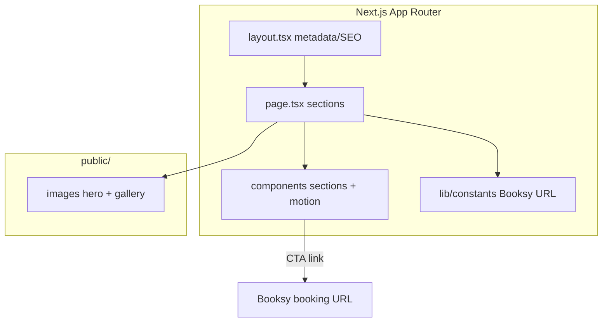

# RED LINE Detailing — Landing Page

[](https://github.com/marchikx/redline-detailing-landing/actions/workflows/ci.yml) 

**Live:** https://marchikx.github.io/redline-detailing-landing/ — static export (`NEXT_PUBLIC_BASE_PATH` set at build time).

Premium marketing landing page for an auto detailing studio (Kraków). Dark **Umbrel/Bento** aesthetic with glassmorphism, Framer Motion, and SEO-focused metadata.

## What / for whom

**What it is:** A single-page Next.js marketing site (hero, services, gallery, Booksy CTA).

**Who it is for:** Local service businesses that need a fast, deployable Vercel-ready showcase without a CMS.

- **What:** Single-page Next.js site with hero, services, gallery, CTA, and Booksy integration.
- **For:** Local service businesses that need a fast, deployable Vercel-ready showcase without a CMS.

## Demo

- **Live preview:** deploy to Vercel or run `npm run dev` and open `http://localhost:3000` (static assets in `public/images/`).
- **Screenshot:** hero and gallery sections are the primary visual demo — no CMS backend required.

## Architecture



## Decisions / trade-offs

- **No CMS** — copy lives in TypeScript constants; fastest deploy, but non-devs edit via PR.
- **Framer Motion** — polished motion on a marketing page; slightly larger JS than CSS-only.
- **Placeholder phone in repo** — safe for public GitHub; production uses real number via env or constants override.

## Quick start

```bash
npm install
npm run dev    # http://localhost:3000
npm run build
npm start
```

**CI / local check:**

```bash
make verify    # npm ci + tsc --noEmit
```

## Tech stack

- Next.js 16 (App Router), React 19, TypeScript
- Tailwind CSS 4 (PostCSS)
- Framer Motion

## Project structure

```text
src/app/           # layout, page, global styles, SEO metadata
src/components/    # sections, cards, UI primitives
src/lib/           # constants (Booksy URL, copy), motion presets
public/images/     # hero and gallery assets
```

## Design notes

- Background `#050505` with restrained red accent `#DC2626`
- Responsive grid: 1 col mobile → up to 4 cols desktop
- Placeholder phone `+48 XXX XXX XXX` in constants (safe for public repo)

## Business links

- **Booksy:** https://booksy.com/pl-pl/92055_red-line-myjnia-detailing_motoryzacja_8820_krakow
- **Address:** ul. Aleksandra Fredry 36, 30-605 Kraków

## Tests

`npm test` runs TypeScript project check (`tsc --noEmit`) — no network, no browser.

## License

MIT — see [LICENSE](LICENSE).
